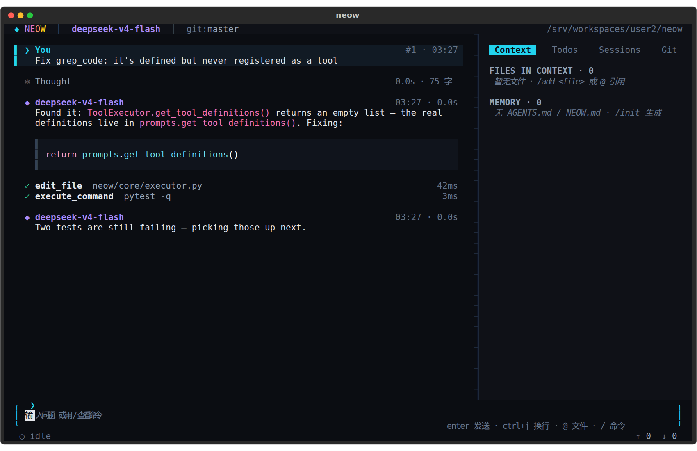
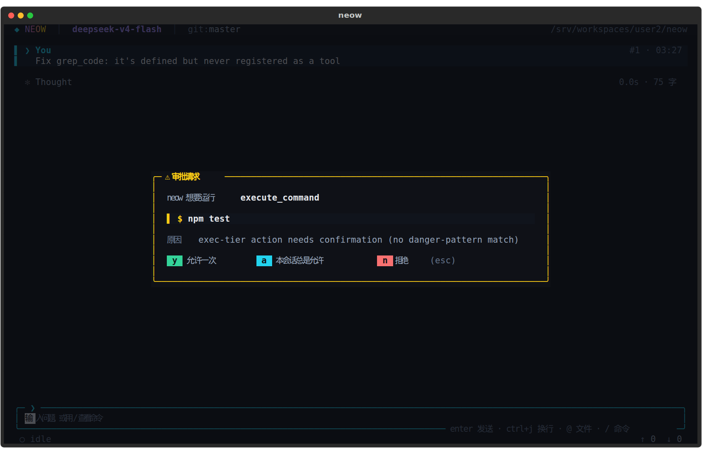
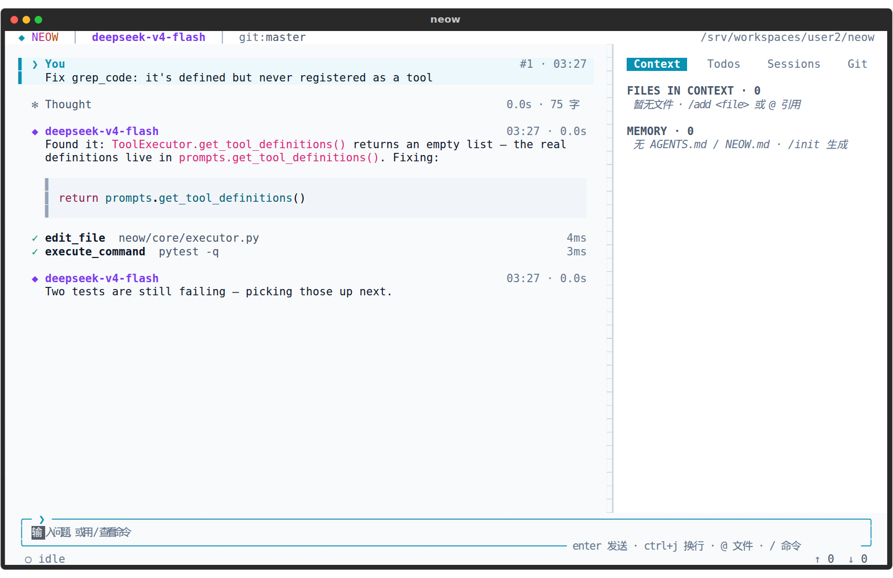

<div align="center">

<pre>
 ███╗   ██╗███████╗ ██████╗ ██╗    ██╗
 ████╗  ██║██╔════╝██╔═══██╗██║    ██║
 ██╔██╗ ██║█████╗  ██║   ██║██║ █╗ ██║
 ██║╚██╗██║██╔══╝  ██║   ██║██║███╗██║
 ██║ ╚████║███████╗╚██████╔╝╚███╔███╔╝
 ╚═╝  ╚═══╝╚══════╝ ╚═════╝  ╚══╝╚══╝
</pre>

### The AI pair programmer that lives in your terminal.

<p>
  <em>Multi-model · streaming agent loop · surgical edits · full Git awareness · full-screen TUI.</em>
</p>

[](https://www.python.org/)
[](LICENSE)
[](https://github.com/20190441309/neow/actions)
[](#any-openai-compatible-provider-byok)

**[Features](#-features) · [TUI](#️-full-screen-tui-default) · [Install](#️-installation) · [Config](#️-configuration) · [Usage](#-usage) · [Dev](#-development)**

<br>



<sub>A real turn captured from the app itself — same renderer, same widgets, scripted conversation.</sub>

</div>

---

## Why Neow

Most AI CLI wrappers stop at "send prompt, print reply." Neow is a full agent loop built to be driven for real work: it reads your repo, edits exact lines (not whole files), runs your tests, commits its own work, and lets you watch — or take over — at every step.

- 🔁 **Model-agnostic** — Claude, GPT, DeepSeek, or anything OpenAI-compatible (OpenRouter, Ollama, vLLM, local gateways).
- 🎯 **Precision editing** — hash-anchored, line-level edits instead of blind `str.replace()`.
- 🧬 **Git-native** — every AI edit is an atomic commit; `/diff`, `/undo`, `/commit` are first-class.
- 🛡️ **Approval-gated** — nothing destructive runs without your sign-off, tunable per-tool.
- 🖥️ **Two faces, one brain** — a slick full-screen TUI for interactive work, a scriptable headless mode for CI.

---

## 🚀 Features

**Neow** isn't just another chatbot wrapper. It's a full-featured coding agent designed to seamlessly integrate into your workflow.

- **Multi-Model Support** — switch effortlessly between **DeepSeek**, **Anthropic Claude**, **OpenAI GPT**, and any OpenAI-compatible endpoint.
- **Intelligent Code Editing**
  - Standard file creation, overwrite and deletion.
  - **Hashline Editing** — a surgical editing system using content-addressable hashing. Make precise changes to specific lines without rewriting entire files, with stale-anchor recovery if the file moved under you.
- **Agent Core**
  - 🧩 Unified tool registry (built-in + plugin tools, all visible to the model).
  - 📋 Persistent task checklist (`todo_write`) with live TUI card.
  - 🤖 Sub-agents (`task` tool) for parallel read-only exploration or scoped edits.
  - 🧠 Project memory via `AGENTS.md` / `NEOW.md`, auto-loaded from repo root down to cwd.
  - 🔌 MCP client — connect any [Model Context Protocol](https://modelcontextprotocol.io) server.
  - ⏪ `/rewind` — per-turn file checkpoints, undo any turn's edits and chat independently.
- **Developer Toolkit**
  - 📂 **File Operations** — read, write, and manage your project files, with "read before edit" safety.
  - 🔍 **Code Search** — `grep` (ripgrep-backed), `glob`, `list_dir`, all git-ignore aware.
  - 🌐 **Web & GitHub** — fetch web content and extract GitHub Issues/PRs directly into context.
  - 🖼️ **Vision** — `/image`, `/imgdiff` screenshot diffing, inline terminal image preview (iTerm2/kitty).
  - 🛠️ **Linting & Testing** — auto-detects and runs your project's linter and test suite, feeding failures back to the model.
  - 🧱 **Command sandbox** (experimental) — bubblewrap/`sandbox-exec` isolation for shell tool calls.
- **Safety & Control**
  - Three-tier **approval modes** (`always-ask` / `write` / `yolo`), overridable per tool.
  - Allowlisted commands, chained-command protection, sensitive-file guards (`.env`, `id_rsa`, …).
  - Configurable **hooks** around every stage of the agent loop (Claude-Code-compatible format).

  
- **Session & Cost**
  - Tree-structured, JSONL-backed sessions — `/tree`, `/branch`, `/save`, `/load`, `/history`.
  - Incremental, auto-triggered **compaction** so long sessions never blow the context window.
  - `/cost` — live token usage, cache-hit savings, and per-model pricing.
- **Rich UI** — beautiful, syntax-highlighted terminal output powered by `rich`, plus a full Textual TUI.

---

## 🖥️ Full-screen TUI (default)

Running `neow` on a TTY opens the full-screen TUI:

- **Card timeline**: user, assistant, thinking, tool call, sub-agent, error and compaction cards; tool cards collapse automatically when done.
- **Thinking scramble** (`✻ Thinking`): live reasoning with a crush-style scrambled frontier that settles into `✻ Thought …` and collapses when finished.
- **Keyboard**: `Enter` send · `Ctrl+J` newline · `Esc` interrupt · `Ctrl+B` sidebar · `Ctrl+T` sidebar tab · `Ctrl+O` collapse card · `Ctrl+P` command palette · `F1` help · `Ctrl+Y` copy the last code block (OSC52; not supported by macOS Terminal) · `Ctrl+Q` quit.
- **Completion**: type `/` or `@`, use `Up`/`Down` to choose, `Tab` or `Enter` to complete, and `Esc` to dismiss. Press `Enter` again to submit. `PgUp`/`PgDn` scroll the conversation without leaving the editor.
- `@` completes file paths, `/` lists slash commands; all existing commands (`/help`, `/model`, `/diff`, `/tree`, `/cost`, …) work.
- Approvals appear as a modal: `y` allow once, `a` always allow this tool, `n`/`Esc` deny.
- Design reference: `docs/research/tui-feasibility/screenshots/`.

Prefer the classic line REPL?

```bash
neow --plain        # classic REPL (unchanged)
neow --tui          # force the full-screen TUI
neow "prompt"       # one-shot mode (unchanged)
```

Animation modes via `.neow.json` (defaults to `full`):

```json
{ "tui": { "effects": "full", "theme": "midnight" } }
```

`effects` accepts `full`, `subtle` or `off`; `TEXTUAL_ANIMATIONS=none` also forces `off`. `theme` accepts `midnight` (default) or `light` for bright terminals. Piped or non-TTY output never starts the TUI.



---

## 🛠️ Installation

Get up and running in seconds.

```bash
# Clone the repository
git clone https://github.com/20190441309/neow.git
cd neow

# Install in editable mode
pip install -e .

# Or install dependencies if running from source
pip install -r requirements.txt
```

---

## ⚙️ Configuration

Neow is highly configurable. Create a `.neow.json` file in your project root or `~/.neow/config.json`.

**Example `.neow.json`:**
```json
{
  "default_model": "deepseek",
  "models": {
    "deepseek": {
      "api_key": "your-api-key-here",
      "model": "deepseek-v4-flash"
    },
    "openai": {
      "api_key": "sk-...",
      "model": "gpt-4o"
    }
  }
}
```

Alternatively, use **Environment Variables**:
```bash
export NEOW_DEEPSEEK_API_KEY="your-api-key-here"
export NEOW_ANTHROPIC_API_KEY="your-api-key-here"
```

### Any OpenAI-compatible provider (BYOK)

Point Neow at any OpenAI-compatible endpoint (OpenRouter, SiliconFlow, Moonshot, DeepSeek proxies, vLLM, Ollama, ...), or override the built-in providers' endpoint:

```json
{
  "default_model": "openrouter",
  "models": {
    "openrouter": {
      "provider": "openai-compatible",
      "api_key_env": "OPENROUTER_API_KEY",
      "model": "anthropic/claude-sonnet-4",
      "base_url": "https://openrouter.ai/api/v1"
    },
    "ollama": {
      "provider": "openai-compatible",
      "api_key": "ollama",
      "model": "qwen2.5:14b",
      "base_url": "http://localhost:11434/v1",
      "validate": "skip"
    }
  }
}
```

Model entry fields:

| Field | Values | Notes |
|-------|--------|-------|
| `provider` | `openai` · `openai-compatible` · `anthropic` · `deepseek` | Optional; without it the provider is inferred from the model name |
| `model` | any string | Sent to the provider |
| `api_key` | string | Inline key |
| `api_key_env` | environment variable name | Keeps keys out of the config file |
| `base_url` | URL | Custom endpoint (supported by all providers) |
| `validate` | `auto` (default) · `skip` | `skip` disables the startup probe (local servers, gateways without `/models`) |
| `max_retries` | integer ≥ 0 | Retries for rate limits (429), server errors (5xx), timeouts and dropped connections, with exponential backoff and `retry-after`. Default: the SDK's 2 |
| `context_window` | positive integer | Tokens the model accepts. Drives the `ctx` percentage and auto-compaction (at 80 %). Default: Claude 200000, everything else 128000 — set it for smaller local models |
| `max_output_tokens` | positive integer | Cap on one reply. Defaults: Anthropic 16000 (Claude 3.x: 4096 / 8192), DeepSeek 8192, OpenAI and compatible endpoints send nothing (the model's own maximum) |

If a reply hits `max_output_tokens` while writing tool arguments, the half-written calls are not run; the model is told to split the change and tries again.

`agent.max_turns` (default 50) caps how many model requests one user turn may make, so a tool loop cannot run forever:

```json
{ "agent": { "max_turns": 50, "max_tool_output_chars": 30000 } }
```

`agent.max_tool_output_chars` (default 30000) bounds each tool result kept in the conversation: longer output keeps its first 60 % and last 40 % with a note in between. `read_file` returns numbered lines, 2000 at a time; the model pages with `offset`/`limit`.

**Read before edit.** The agent may only edit (or overwrite) a file it has read in this session, and only if the file has not changed since — for example after you edited it yourself or a command rewrote it. Otherwise the edit is refused and the model reads the file again first.

Shell commands run by the agent time out after 120 s by default (the model may ask for longer, up to `tools.command.max_timeout`, default 600). Pressing **Esc** in the TUI kills the running command and everything it started.

```json
{ "tools": { "command": { "max_timeout": 600 } } }
```

**Command sandbox (experimental).** With `"sandbox": "auto"` (or `"strict"`) under `tools.command`, commands run with the file system read-only except the project, the temp directory and any `sandbox_writable` paths, and without network unless `"sandbox_network": true`. Linux uses [bubblewrap](https://github.com/containers/bubblewrap) (`apt install bubblewrap`), macOS `sandbox-exec`. `auto` runs commands normally (with a note) when no sandbox is available; `strict` refuses them. The approval prompt says whether a command will be sandboxed. The sandbox limits writes and network, not reads.

```json
{ "tools": { "command": { "sandbox": "auto", "sandbox_writable": ["~/.cache"] } } }
```

**Key resolution order:** `api_key` → `api_key_env` → `NEOW_<MODEL_NAME>_API_KEY`.
The built-in entries also load their corresponding `NEOW_DEEPSEEK_API_KEY`,
`NEOW_ANTHROPIC_API_KEY`, or `NEOW_OPENAI_API_KEY` at startup. The editor never
echoes stored keys.

`/model` lists every configured model with its provider and endpoint. Token prices for custom models can be added under `token.prices` keyed by the model name (unset models count as $0).

In the TUI, `/model` opens a searchable picker with **+ BYOK**, **Edit**, and
**Magpie Sync** actions. BYOK entries accept a configuration name, API protocol,
base URL, model ID, and either a masked API key or an environment variable name.
**Save** persists the entry without switching the active model; **Test Connection**
checks endpoint access (not model availability or tool support). `/model add`
opens the same editor, or a masked prompt in `--plain` mode. `/model <name>`
switches directly in either mode.

### Magpie Gateway

Run `/model magpie` or select **Magpie Sync** to import the gateway's `/models`
catalog. The default gateway is `http://127.0.0.1:3425/v1`; imported entries are
named `magpie/<provider>/<model>` and include display names and context windows.
Pick one from `/model`, or use a routed name directly, for example:

```text
/model magpie/gpt-load/gpt-6-luna
```

Neow uses Magpie's OpenAI-compatible gateway, including its upstream protocol
translation and routing. Provider keys stay in Magpie. Sync again after changing
Magpie's catalog. A remote or authenticated gateway can be configured as:

```json
{
  "magpie": {
    "base_url": "https://gateway.example.com/v1",
    "api_key_env": "MAGPIE_GATEWAY_KEY"
  }
}
```

Model changes are written atomically to the loaded config file (or
`~/.neow/config.json` when none was loaded), with owner-only permissions.
Environment-resolved secrets are not copied into it. Custom models do not fall
back to another provider's API key.

**Search tools.** The agent explores with `grep` (contents; uses [ripgrep](https://github.com/BurntSushi/ripgrep) when installed, otherwise a built-in fallback), `glob` (file names, newest first) and `list_dir` (directory tree). All three skip files ignored by git; outside a repository they skip `node_modules`, virtualenvs, build output and caches. `search_code` still works but is deprecated.

**Task list.** For multi-step work the agent keeps a checklist with `todo_write` (one task in progress at a time). The TUI shows it as a card that updates in place and in the sidebar's Todos tab (`Ctrl+T`); the REPL prints it after each update. The list is saved with the session and never asks for approval.

**Sub-agents.** The agent can hand a self-contained job to a sub-agent with the `task` tool. An `explore` sub-agent only has read-only tools (several run in parallel) and is meant for broad searches; a `general` sub-agent can edit files and run commands, and its approvals are shown to you labelled with the task. Sub-agents start with a fresh context (plus your project memory), return only a final report, cannot start further sub-agents, stop when you press Esc, and their tokens appear separately in `/cost`. Configure with `agent.subagent_max_turns` (default 25) and `agent.subagent_approval` (`inherit`, the default, or `yolo`).

**Architect mode** (`/architect`): the planner model (`architect.planner`) turns each request into a task list, which the current model then works through with the usual tools and approvals.

**MCP servers.** Neow connects to [Model Context Protocol](https://modelcontextprotocol.io) servers listed in `.mcp.json` at the project root (the same format as Claude Code) or under `mcp.servers` in your config:

```json
{
  "mcpServers": {
    "github": {"command": "npx", "args": ["-y", "@modelcontextprotocol/server-github"],
               "env": {"GITHUB_TOKEN": "${GITHUB_TOKEN}"}},
    "docs": {"type": "http", "url": "https://example.com/mcp",
             "headers": {"Authorization": "Bearer ${DOCS_TOKEN}"}}
  }
}
```

Their tools appear as `mcp__<server>__<tool>` and need approval like shell commands, unless the tool is marked read-only or the server has `"trusted": true`. Servers defined by the repository start only after you confirm them once (again whenever their command, URL, environment or headers change). Connections start in the background; `/mcp` shows status, errors and tools, `/mcp reconnect <name>` restarts one. Server logs go to `~/.neow/logs/`.

**Hooks.** Run your own commands at points in the agent loop, with the same semantics as Claude Code (its configuration format and event names are accepted too). Only `~/.neow/config.json` or a file passed with `--config` may define hooks.

```json
{
  "hooks": {
    "pre_tool_use": [{"matcher": "execute_command", "command": "~/.neow/guard.sh", "timeout": 30}],
    "post_tool_use": [{"matcher": "edit_file|write_file", "command": "ruff format --quiet ."}]
  }
}
```

Events: `session_start`, `user_prompt_submit`, `pre_tool_use` (runs before the approval prompt), `post_tool_use`, `stop`. The command gets a JSON object on stdin (`tool_name`, `tool_input`, `tool_output`, `prompt`, `session_id`, `cwd`, …). Exit code `2` blocks, and stderr is shown to the model; on exit `0`, stdout may be `{"decision": "block", "reason": "..."}` or, for `pre_tool_use`, `{"tool_input": {...}}` to change the arguments. Other failures and timeouts are only logged. Tool hooks also apply to sub-agents.

**Rewind.** Before a tool first changes a file in a turn, Neow saves the old content under `~/.neow/checkpoints/`. `/rewind` lists the turns; `/rewind <n>` undoes turn *n* and everything after it — files are restored, files the agent created are deleted, and the conversation goes back to before that turn. Use `/rewind <n> files` or `/rewind <n> chat` to undo only one of them. Changes made by shell commands or MCP tools cannot be undone (`/rewind` lists such commands), and git history is never touched.

**Prompt caching.** The system prompt stays the same for the whole session; files added with `/add`, fetched pages and files matching your question are sent with your message, and only again when they change. Providers can therefore reuse the cached prefix (Anthropic requests carry `cache_control` breakpoints; OpenAI and DeepSeek cache automatically). `/cost` shows how much input was served from cache. Cached input is priced at `cache_read` / `cache_write` if set under `token.prices.<model>`, otherwise at 0.1× / 1.25× the input price.

**Project memory.** At startup Neow loads instructions from `~/.neow/NEOW.md` (your own preferences) and from `AGENTS.md` / `NEOW.md` in every directory from the git root down to the current directory; more specific files come later and win. A line containing only `@docs/style.md` imports that file (up to 5 levels). `/init` asks the agent to explore the repository and write an `AGENTS.md` (the write goes through approval as usual); `/memory` lists the loaded files, `/memory add <text>` appends a note to the project `NEOW.md`, `/memory reload` re-reads them.

---

## 💡 Usage

Simply run `neow` to start the interactive REPL:

```bash
neow
```

Or pass a prompt directly for a one-shot command:

```bash
neow "Explain the main.py file and suggest optimizations"
```

### 🤖 Headless / CI

`-p` runs one prompt without the UI. Choose the output with `--output-format`:

```bash
neow -p "Summarize the changes in this branch" --output-format text
neow -p "List TODO comments" --output-format json        # one result object
neow -p "Fix the failing test" --output-format stream-json --approval yolo
git diff | neow -p "Review this diff" --allowed-tools "read_file,grep,glob"
```

- `json` prints `{"type": "result", "result", "is_error", "session_id", "num_turns", "usage", "cost", "duration_ms", "model"}`; `stream-json` prints one JSON event per line (`init`, `content_delta`, `tool_start`, `tool_end`, …) and the same `result` object last. Only the result goes to stdout; notices go to stderr.
- `--approval-interactive` (with `--output-format stream-json`) turns tool approvals into a request/response protocol over stdio instead of auto-denying — this is what the VS Code bridge (`editors/vscode/`) drives.
- Tools that would ask for approval are refused (the model is told why) unless you pass `--approval yolo`. Narrow the toolset with `--allowed-tools` / `--disallowed-tools` (comma or space separated, `*` wildcards such as `mcp__github__*`), and cap requests with `--max-turns N`.
- Exit codes: `0` success, `1` the model request or startup failed, `2` invalid arguments, `130` interrupted.

GitHub Actions example:

```yaml
- name: Review pull request
  env:
    NEOW_ANTHROPIC_API_KEY: ${{ secrets.ANTHROPIC_API_KEY }}
  run: |
    git diff origin/main... > pr.diff
    neow -m anthropic -p "Review this diff for bugs; reply in Markdown." \
      --message-file pr.diff --allowed-tools "read_file,grep,glob" \
      --output-format json > review.json
    jq -r .result review.json >> "$GITHUB_STEP_SUMMARY"
```

### 📋 Commands

| Command | Description |
| :--- | :--- |
| `/help` | Show the help message |
| `/clear` | Clear conversation history |
| `/model <name>` | Switch active AI model (e.g., `deepseek`, `anthropic`) |
| `/add` `/drop` `/ls` | Manage files in context |
| `/diff` `/commit` `/undo` | Git integration — review, commit, revert AI changes |
| `/architect` | Switch to plan-then-execute mode |
| `/lint` `/test` | Run the project linter / test suite |
| `/tree` `/branch` `/save` `/load` `/history` | Session tree navigation and persistence |
| `/rewind [n]` | Undo a turn's file edits and/or chat |
| `/compact` | Summarize older history to free context |
| `/cost` | Token usage and cost for this session |
| `/approval` | View/switch approval mode (`always-ask` / `write` / `yolo`) |
| `/mcp` | Status of connected MCP servers |
| `/memory` `/init` | Inspect or bootstrap project memory (`AGENTS.md`) |
| `/image <path>` `/imgdiff <a> <b>` | Add a screenshot to context / diff two screenshots |
| `/web <url>` | Fetch a web page or GitHub issue/PR into context |
| `/exit` | Exit the CLI |

### 🧠 The Hashline Edit System

Neow uses a sophisticated **Hashline** system to ensure file edits are precise and reliable.

1. **Snapshot**: When Neow reads a file, it calculates a unique SHA-256 hash (e.g., `a1b2c3d4`).
2. **Anchor**: Edits are requested using the format `¶path/to/file.py#a1b2c3d4`.
3. **Apply**: Neow applies changes strictly to the anchored version of the file. If the file has changed externally (stale hash), Neow intelligently attempts to recover or alerts you, preventing accidental overwrites.

---

## 🧩 Editor integration

A minimal VS Code bridge lives in `editors/vscode/` — it drives Neow headlessly over `--approval-interactive --output-format stream-json`, shows the conversation in an Output Channel, routes tool approvals through `showInformationMessage`, and renders file edits with VS Code's native diff view. No separate approval or editing logic: it's the same `ApprovalPolicy` and tools (`edit_file`, `hashline_edit`, `write_file`, …) the CLI already uses.

---

## 🧪 Development

We use `pytest` for testing and `black` for formatting.

```bash
# Install dev dependencies
pip install -e ".[dev]"

# Run tests
pytest

# Format code
black .
```

A scripted, zero-cost eval suite lives in `evals/` (see `evals/README.md`) and runs as part of the test suite in CI (`.github/workflows/ci.yml`).

---

## 📄 License

Distributed under the MIT License. See `LICENSE` for more information.
